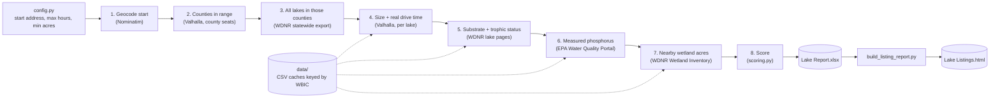

# Wisconsin Lake Ranking

[](https://github.com/fredr171/wisconsin-lake-ranking/actions/workflows/ci.yml)

A Python pipeline that ranks every Wisconsin lake within a drive-time limit on two
questions a lake-property buyer cares about:

- **Climate Score:** will this lake stay cool and clean as summers get hotter?
- **Mosquito Score:** how bad will mosquitoes be on a waterfront property here?

It pulls from five free public sources (state lake records, lake web pages, a wetland map
service, EPA water-quality data and an open routing engine), caches every expensive
lookup, and scores each lake with explicit guardrails for missing or thin data. The
output is a spreadsheet and a single-file, searchable HTML page.

**Why it exists:** I built this to decide where to buy lakefront land, and I did: the lot
I bought is on a lake in the top 3% of this ranking. The scores narrowed 16,917 lakes to a
shortlist; price, availability and a site visit made the final call.

**A run from Minneapolis City Hall with a 3.5-hour limit:** 16,917 lakes statewide →
1,275 candidates of 75+ acres → 647 within the real drive time → 609 scored (the rest
have no usable data) → 574 named lakes on the listings page.

**Stack:** Python 3.11+, pandas, BeautifulSoup, urllib, pytest. No database or cloud
services; the caches are CSV files.

## What to look at

| If you want to see... | Look at |
|---|---|
| The results | **[Live listings page](https://fredr171.github.io/wisconsin-lake-ranking/)** (`output/Lake Listings.html`, served by GitHub Pages) or `output/Lake Report.xlsx` |
| How a lake is scored | [`scoring.py`](scoring.py): pure functions, top to bottom. [`docs/methodology.md`](docs/methodology.md) explains each rule. |
| How the data is gathered | [`lake_finder.py`](lake_finder.py): one function per pipeline step, run in order by `main()` |
| How the scoring was checked | [`docs/validation.md`](docs/validation.md): data-quality catches, review rounds, what was adopted and rejected |
| Tests | [`tests/`](tests/): scoring guardrails and failure handling, all offline. CI runs `ruff` and `pytest` on every push |

## How it works



The steps are ordered from cheapest to most expensive. Free filters (size, coordinates)
run before routing, and routing runs before any per-lake scraping, so nothing is fetched
only to be thrown away. Every lake is keyed by its **WBIC**, the Wisconsin DNR's
permanent waterbody ID. Names won't do as a key, because one county can have two lakes
with the same name.

## Design decisions

### Failures stay visible and get retried
- **A failure is never stored as data.** A lake that can't be routed is reported as
  unrouted, not as "too far". A failed wetland or lake-page lookup leaves that field
  blank for this run and is **not cached**, so the next run retries it. The public
  routing server fails silently under load, so routing runs at most 4 requests at once,
  with retries and backoff.
- **Source data is checked, not trusted.** WDNR's export places 251 lakes at
  coordinates (0, 0) and drops the minus sign from 13 longitudes. Out-of-state
  coordinates are skipped with a warning; dropped signs are repaired and counted.
- **Each step prints its counts and warnings**, e.g. `Step 4c: WARNING - 3 lakes could
  not be routed after retries ... re-run to retry them`.

### Re-runs are cheap and safe
- **Every expensive result is cached by WBIC** in `data/`, so a re-run fetches only lakes
  it hasn't seen. Lake-level caches (substrate, phosphorus, wetlands) are valid for any
  start point. Drive-time caches are thrown away automatically when `START_ADDRESS` changes.
- **Writes are atomic** (temp file, then rename), so an interrupted run never leaves a
  truncated cache or download behind.

### Missing data is visible, not hidden in the math
- **Weights renormalize** around the components a lake actually has, so a missing
  reading neither helps nor hurts.
- **Confidence cap:** a lake whose data covers under half the total weight is capped at
  65, so a lake known only by its "Seepage" label can't outrank lakes with real measurements.
- **Every row shows its evidence:** `Fields Used`, `Confidence` (High / Moderate / Low /
  Screening only), `Depth Basis` (measured vs. estimated), and a `Data Flag` column for
  caveats such as a possible flooded mine pit.

### Guardrails come from failure cases
Each guardrail exists because a specific lake scored wrongly without it: a wide, shallow
lake rewarded for its volume, an 8 ft lake scoring 73.5, a trout bonus pushing a shallow
lake past its cap. The cases are in [`docs/methodology.md`](docs/methodology.md#guardrails).

### Claims are checked before they change the model
The scoring went through several rounds of AI review. Every concrete claim was tested
against the data first. Some changes were adopted: a leave-one-out ranking test
(Spearman ρ) backed cutting one weight. Others were rejected, such as a claimed size bias
in the wetland data (measured correlation 0.092) and a "DNR stratification test" that
doesn't exist. The full record is in [`docs/validation.md`](docs/validation.md).

## Scoring at a glance

| Climate Score | Weight | | Mosquito Score | Weight |
|---|---|---|---|---|
| Est. volume (acres × depth, adjusted for shallowness and basin shape) | 35% | | Nearby wetland acres | 45% |
| Lake type (groundwater- vs. stream-fed) | 25% | | Wind exposure (lake size) | 28% |
| Bottom substrate (100 − muck %) | 25% | | Bottom substrate | 11% |
| Water quality (phosphorus → trophic status → clarity) | 15% | | Water quality | 9% |
| Trout present | +8 | | Lake type | 7% |

Both scores run 0-100, and higher is better. The listings page orders lakes 60/40
climate/mosquito; the spreadsheet is sorted by Climate Score. Formulas, constants and
their reasoning: [`docs/methodology.md`](docs/methodology.md).

## Run it

```bash
python -m venv .venv
.venv/Scripts/python -m pip install -r requirements-dev.txt   # macOS/Linux: .venv/bin/python
.venv/Scripts/python -m pytest                               # 40 offline tests, a few seconds
.venv/Scripts/python lake_finder.py                          # writes output/Lake Report.xlsx
.venv/Scripts/python build_listing_report.py                 # writes output/Lake Listings.html
```

Settings are in [`config.py`](config.py): `START_ADDRESS` (a public landmark by
default; any address OpenStreetMap can geocode works), `MAX_DRIVE_HOURS` and `MIN_ACRES`.

**Runtime:** with the committed caches, a re-run takes about 20 seconds and makes no
network calls beyond geocoding. A new start address re-routes every candidate lake from
scratch: about 1,300 calls to a free public server, roughly half an hour, saved every 100
lakes so an interrupted run picks up where it stopped. The 6 MB EPA station list isn't
committed and downloads automatically the first time it's needed.

## Project layout

```
config.py                 run settings
lake_finder.py            pipeline steps 1-8 (network, caching, export)
scoring.py                Climate and Mosquito scores (pure functions)
build_listing_report.py   HTML listings page from the spreadsheet
zillow_overrides.py       hand-picked Zillow search areas for awkwardly shaped lakes
docs/methodology.md       every scoring rule and its reasoning (also embedded in the HTML page)
docs/validation.md        what was checked, found, adopted and rejected
tests/                    pytest suite, no network
data/                     caches written by lake_finder.py (never hand-edited)
output/                   Lake Report.xlsx, Lake Listings.html
index.html                GitHub Pages entry point (redirects to the listings page)
```

## Limitations

- **A side project, not a production system.** It runs from the command line, keeps state
  in CSV files, and has no scheduler or alerting.
- **Proxies, not direct measurements.** No public data source measures bacteria, weed
  density or mosquito counts. Depth, lake type, substrate, nutrients and wetlands are
  stand-ins.
- **No watershed or land-use data.** It exists, but using it needs a GIS pipeline (spatial
  joins, land-cover rasters).
- **Lake-level, not property-level.** Without shoreline polygons or wind direction, a
  windward shore and a sheltered bay on the same lake get the same Mosquito Score.
- **Data gaps carry through.** The wetland inventory has a confirmed gap along part of the
  Mississippi River, and some lake pages have no substrate data. Both appear as missing
  data and lower confidence, never as filled-in values.
- **Wisconsin only.** The bulk lake export is specific to Wisconsin's DNR.

More detail: [`docs/methodology.md`](docs/methodology.md#known-limitations).

## Data sources

All public, with no API keys:
- **Wisconsin DNR:** statewide lake export, per-lake pages, and the Wisconsin Wetland
  Inventory (ArcGIS REST)
- **EPA / USGS Water Quality Portal:** phosphorus measurements
- **OpenStreetMap:** Nominatim geocoding and Valhalla routing (FOSSGIS public server)

Zillow links are plain URLs to Zillow's own map search. No listing data is collected or stored.

## How this was built

I designed this project and directed and verified the work. I wrote the code with AI
assistance (Claude Code). AI models (Gemini, ChatGPT) also acted as outside reviewers of
the scoring. Their suggestions were treated as hypotheses, and each was tested against
the data before it was adopted or rejected (see [`docs/validation.md`](docs/validation.md)).

## License

The code is released under the [MIT License](LICENSE). The source data keeps its own
terms: OpenStreetMap data is © OpenStreetMap contributors under the ODbL, and WDNR and
Water Quality Portal data come from their public sources (see [Data sources](#data-sources)).
